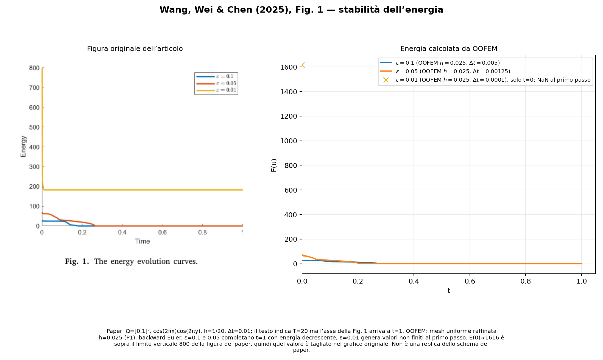
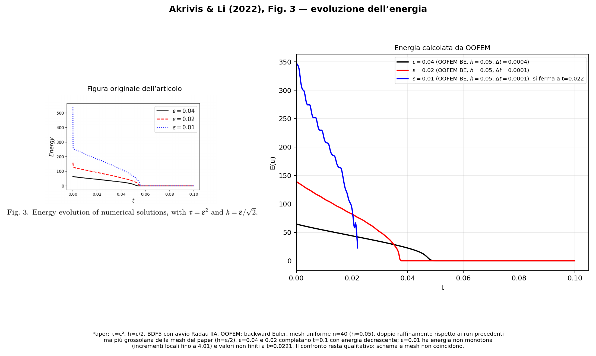

# Confronto Allen–Cahn con due articoli

Nota di lavoro aggiornata il 22 ottobre 2026. I due articoli sono stati letti dai PDF forniti dall’utente.

## Equazioni e corrispondenza con OOFEM

Entrambi gli articoli considerano, nel bulk,

\[
u_t-\Delta u+\varepsilon^{-2}(u^3-u)=0,
\qquad\text{ossia}\qquad
u_t-\Delta u=\varepsilon^{-2}(u-u^3).
\]

Nel materiale OOFEM questo corrisponde a `c=1`, `k=1`, `mobility=1/epsilon^2`. I casi qui riprodotti sono **Allen–Cahn di bulk**: non verificano la condizione di bordo dinamico sviluppata nel progetto.

## Wang, Wei e Chen (2025): prova MMS

Articolo: *Optimal error estimates for the semi-discrete and fully-discrete finite element schemes of the Allen–Cahn equation*, JCAM 462 (2025), 116469, DOI 10.1016/j.cam.2024.116469. I dati sono in §5.1, tabelle 1 e 2.

Il paper usa \(\Omega=[0,1]^2\), Neumann omogenea, elementi P1, \(T=0.5\), \(\varepsilon=0.5\) e soluzione esatta

\[
u^*(x,y,t)=\cos(\pi x)\cos(\pi y)\sin(t),\qquad u^*(x,y,0)=0.
\]

La sorgente MMS è stata derivata direttamente dall’equazione:

\[
g=u_t^*-\Delta u^*+\varepsilon^{-2}\big((u^*)^3-u^*\big),
\]

e inserita nel lato destro. È stato aggiunto al materiale Allen–Cahn il profilo temporale MMS sinusoidale `mmstemporal 1`; il profilo esponenziale preesistente resta quello predefinito (`mmstemporal 0`). L’input di regressione piccolo è [allencahn_paper_mms_sine.in](../tests/tm/allencahn_paper_mms_sine.in).

Sono state generate mesh triangolari uniformi e misurate le norme integrate dell’errore fra soluzione P1 e soluzione esatta con quadratura triangolare. Il valore H1 riportato sotto è il seminorma del gradiente, calcolato con la stessa quadratura.

### Raffinamento spaziale con \(\tau=h^2\)

| n per lato | \(\|e\|_{L^2}\) OOFEM | ordine | \(|e|_{H^1}\) OOFEM | ordine | \(L^2\) paper | \(H^1\) paper |
|---:|---:|---:|---:|---:|---:|---:|
| 4  | 7.336e-2 | — | 3.940e-1 | — | 2.632e-1 | 3.880e-1 |
| 8  | 1.587e-2 | 2.21 | 2.052e-1 | 0.94 | 7.388e-2 | 1.931e-1 |
| 16 | 3.921e-3 | 2.02 | 1.040e-1 | 0.98 | 1.908e-2 | 9.531e-2 |
| 32 | 9.791e-4 | 2.00 | 5.219e-2 | 0.99 | 4.813e-3 | 4.639e-2 |

Gli ordini asintotici di OOFEM sono quelli attesi per P1: circa 2 in L2 e 1 in H1. I valori H1 sono vicini a quelli della tabella del paper. **I valori L2 assoluti, invece, non coincidono**: OOFEM dà valori circa 3–5 volte più piccoli in questa sequenza. Il trend converge con l’ordine atteso, ma il dato quantitativo del paper resta da riconciliare (norma usata, mesh effettiva e dettagli dello schema basato sul moltiplicatore di Lagrange).

### Raffinamento con \(\tau=h\)

| n per lato | \(\|e\|_{L^2}\) OOFEM | ordine | \(|e|_{H^1}\) OOFEM | ordine |
|---:|---:|---:|---:|---:|
| 8   | 2.551e-2 | — | 2.053e-1 | — |
| 16  | 4.797e-3 | 2.41 | 1.040e-1 | 0.98 |
| 32  | 1.181e-3 | 2.02 | 5.221e-2 | 0.99 |
| 64  | 3.281e-4 | 1.85 | 2.613e-2 | 1.00 |
| 128 | 1.031e-4 | 1.67 | 1.307e-2 | 1.00 |

Nel paper la tabella 1 riporta ordine circa 1 sia per L2 sia per H1 e valori L2 molto maggiori (ad esempio 1.747e-2 a n=128 contro 1.031e-4 qui). Quindi **questa tabella non è stata riprodotta quantitativamente**. La verifica analitica dell’input e la convergenza spaziale separata passano, ma il confronto con il metodo del paper non è ancora validato. Inoltre il run \(n=4,\tau=h=1/4\) non converge: il Jacobiano iniziale di Newton è singolare per questa combinazione di passo e reazione. Il paper usa una discretizzazione basata sul moltiplicatore di Lagrange; OOFEM qui usa backward Euler implicito sul campo Allen–Cahn originale.

## Akrivis e Li (2022): interfaccia ellittica e convergenza temporale

Articolo: *Error estimates for fully discrete BDF finite element approximations of the Allen–Cahn equation*, IMA Journal of Numerical Analysis 42 (2022), 363–391, DOI 10.1093/imanum/draa065. Il testo allegato è il preprint accettato del 2020. I dati numerici sono in §6, Tabella 1.

È stato riprodotto il caso \(\varepsilon=0.04\), dominio \([-1,1]^2\), interfaccia ellittica con semiassi 0.6 e 0.2, dato iniziale

\[
u_0(x)=\tanh\!\left(\frac{\Lambda_0(x)}{\sqrt{2}\,\varepsilon}\right),
\]

dove \(\Lambda_0\) è la distanza con segno dall’ellisse, e Dirichlet \(u=1\) sul bordo. Per la Tabella 1 il paper usa \(T=8\varepsilon^2=0.0128\) e \(h=\varepsilon/2\): per \(\varepsilon=0.04\), \(h=0.02\). I precedenti run temporali OOFEM usavano invece 20 divisioni per lato, con lato di griglia \(h=0.1\); i valori assoluti non sono quindi un confronto a mesh pari e non vanno presentati come replica quantitativa della tabella. I tre input pronti sono in [`doc/allen_cahn_paper_cases`](allen_cahn_paper_cases/).

Il paper confronta backward Euler con la propria soluzione a passo dimezzato. OOFEM ha solo il backward Euler; il confronto quindi è fatto fra due run BE consecutivi, non con BDF5. La norma L2 della differenza è integrata esattamente per campi P1 (quadratura triangolare di grado 2).

| \(\tau\) | errore BE \(\|u_\tau-u_{\tau/2}\|_{L^2}\), paper | OOFEM | rapporto OOFEM/paper |
|---:|---:|---:|---:|
| \(2^{-6}\varepsilon^2\) | 9.840e-5 | 1.774e-4 | 1.80 |
| \(2^{-7}\varepsilon^2\) | 4.914e-5 | 8.863e-5 | 1.80 |

Dimezzando il passo, l’errore BE di OOFEM si dimezza circa: questo è coerente con l’ordine 1 del metodo. Tuttavia, dato che la mesh OOFEM era più grossolana di quella della tabella, il rapporto fra errori assoluti non convalida il valore del paper. Questi dati verificano solo il trend temporale del nostro BE sulla mesh usata.

La mesh grossolana può produrre overshoot e non risolve l’interfaccia: il run temporale precedente aveva min/max circa −1.126 / 1.065. Questo dato non è adatto a convalidare il comportamento fisico spaziale.

## Confronto diretto con le figure di energia dei paper

Le immagini affiancano la figura estratta dall’articolo e l’energia ricalcolata dalle soluzioni OOFEM. L’energia OOFEM è integrata sugli elementi P1 con quadratura di grado 4. In questo aggiornamento tutti i sei casi sono stati rigenerati su una griglia uniforme con 40 divisioni per lato: \(h=0.025\) per Wang e \(h=0.05\) per Akrivis–Li, il doppio della risoluzione dei run precedenti. Il dato iniziale ellittico è valutato ai nuovi nodi dalla distanza con segno; sui nodi comuni differisce al massimo di \(5.1\cdot10^{-4}\) dal precedente input. Nei run archiviati, eseguiti prima della correzione del controllo di convergenza, il programma poteva proseguire dopo un NaN; il codice ora arresta il passo non lineare quando rileva residui o incrementi non finiti.

### Wang, Wei e Chen (2025), Fig. 1

OOFEM usa backward Euler e la mesh raffinata \(h=0.025\); il paper usa \(h=0.05\) e uno schema diverso con stabilità energetica. Con i passi temporali precedenti, \(\varepsilon=0.1\) e \(0.05\) completano l’intervallo visibile fino a \(t=1\), con energia monotona e finale quasi nullo. Per \(\varepsilon=0.01\), i valori diventano non finiti al primo passo \(t=10^{-4}\): non c’è una curva valida oltre il punto iniziale. Il raffinamento non risolve questo problema. Il testo dichiara \(T=20\), mentre l’asse della figura termina a \(t=1\).

La mesh raffinata dà \(E(0)\simeq1615.9\) per \(\varepsilon=0.01\). La figura del paper ha l’asse verticale limitato a 800 e la curva tocca il bordo superiore: il valore iniziale è quindi fuori scala, non un riferimento leggibile pari a 800. Non abbiamo evidenza di una discrepanza nell’energia iniziale da questo grafico.

### Akrivis e Li (2022), Fig. 3

Il paper usa BDF5, avvio Radau IIA e \(h=\varepsilon/2\). OOFEM usa backward Euler su griglia uniforme \(h=0.05\), più grossolana del paper: il paper usa rispettivamente h=0.02, 0.01 e 0.005 per epsilon=0.04, 0.02 e 0.01. I casi \(\varepsilon=0.04\) e \(0.02\) completano \(t=0.1\) con energia monotona fino a valori prossimi a zero. Per \(\varepsilon=0.01\), l’energia non è monotona (incrementi locali fino a 4.01) e diventa non finita a \(t\simeq0.0221\); la curva è valida solo fino a circa \(t=0.022\). L’energia iniziale scende da circa 550 sulla mesh precedente a 346 sulla mesh raffinata, segno che la risoluzione influisce sensibilmente sull’interfaccia, ma il run resta invalido.

| Articolo/caso | \(h\) OOFEM | Esito del run raffinato |
|---|---:|---|
| Wang, \(\varepsilon=0.1\) | 0.025 | finito fino a \(t=1\), energia decrescente |
| Wang, \(\varepsilon=0.05\) | 0.025 | finito fino a \(t=1\), energia decrescente |
| Wang, \(\varepsilon=0.01\) | 0.025 | non finito al primo passo \(t=10^{-4}\) |
| Akrivis–Li, \(\varepsilon=0.04\) | 0.05 | finito fino a \(t=0.1\), energia decrescente |
| Akrivis–Li, \(\varepsilon=0.02\) | 0.05 | finito fino a \(t=0.1\), energia decrescente |
| Akrivis–Li, \(\varepsilon=0.01\) | 0.05 | energia non monotona; non finito a \(t\simeq0.0221\) |

Il raffinamento migliora la risoluzione, ma il confronto non è una replica quantitativa: gli schemi temporali restano diversi e Akrivis–Li richiede \(h=\varepsilon/2\). Per \(\varepsilon=0.01\) persiste inoltre il problema di non-finitezza.

## Stato della validazione

- È stata aggiunta in modo opt-in l’integrazione BDF di ordine 1–5 a `NLTransientTransportProblem`, limitata a passo uniforme e `alpha 1`. La partenza cresce da BDF1 fino all’ordine richiesto; **non implementa ancora i quattro passi iniziali Radau IIA di Akrivis–Li**.
- Il caso Fig. 3 di Akrivis–Li con \(\varepsilon=0.04\) è stato rigenerato con \(h=\varepsilon/2=0.02\), \(\tau=\varepsilon^2\), mesh triangolare uniforme e tangente Newton riassemblata a ogni iterazione. Completa 63 passi fino a \(t=0.1008\); il tentativo con tangente modificata si arrestava a \(t=0.056\).
- La connettività originale della mesh non è pubblicata nel paper: questa replica usa gli stessi parametri \(h\), \(\tau\) e gli stessi dati, ma una griglia strutturata OOFEM. Restano da implementare l’avvio Radau IIA a tre stadi e lo schema P1 accoppiato \((\phi_h,u_h)\) di Wang; perciò non è ancora una riproduzione identica completa.
- Sono predisposti anche gli input Fig. 1 di Wang con griglia triangolare \(h=1/20\), \(\Delta t=0.01\), dato iniziale e parametri \(\varepsilon\) dell’articolo. Il solver standard BE converge per \(\varepsilon=0.1\) con Newton completo, ma per \(\varepsilon=0.05\) non converge al passo 7: lo schema ausiliario accoppiato del paper è sostanziale e non si può sostituire col solo cambio di mesh.
- Controllo di stato del 22 ottobre 2026: i run Akrivis–Li \(\varepsilon=0.04\) e \(0.02\) erano terminati correttamente a \(t=0.1008\) e \(t=0.1\); Wang \(\varepsilon=0.1\) era terminato, mentre Wang \(\varepsilon=0.05\) era fallito per mancata convergenza al passo 7. Il run Akrivis–Li \(\varepsilon=0.01\) con \(h=0.005\), \(\tau=10^{-4}\), BDF5 convergeva fino al passo 17/1000, ma è stato fermato perché il solver diretto impiegava circa 22 s per passo. Il build PETSc separato non è configurabile: mancano gli header MPI (`mpi.h`), e il sistema ha negato l’installazione di `libopenmpi-dev`. Quindi questo caso è ancora incompleto.

- Build Debug riuscita.
- `ctest -R allencahn`: 6/6 test passati, incluso il nuovo input MMS sinusoidale.
- La formulazione di sorgente MMS coincide con quella ricavata dall’equazione analitica.
- Per Wang et al. gli ordini di raffinamento spaziale sono corretti; i valori L2 e il test simultaneo spazio-tempo non coincidono ancora con le tabelle del paper.
- Il raffinamento delle figure di energia è stato raddoppiato a 40 divisioni per lato e tutti e sei i run sono stati rilanciati. Quattro casi restano finiti e dissipativi; i due casi con \(\varepsilon=0.01\) producono valori non finiti (subito per Wang, a \(t\simeq0.0221\) per Akrivis–Li). Non è ancora una replica quantitativa dei paper.
- Per Akrivis–Li le curve non coincidono con la Fig. 3: schema temporale e mesh differiscono. La tabella temporale precedente dimostra al più il trend di primo ordine di BE su mesh grossolana, non la replica della tabella del paper.
- Nessuno dei due articoli considera il bordo dinamico del progetto. Questi casi riguardano il bulk, ma i confronti attuali non bastano a dichiararlo pienamente validato.

Gli input originali e gli script di raffinamento/confronto sono in `doc/allen_cahn_paper_cases/`; gli input e i campi VTK dei nuovi run sono in `/tmp/ac_refined/`. I run precedenti restano in `/tmp/ac_paperplots/`; i run MMS delle tabelle sono in `/tmp/ac_paper1/` e `/tmp/ac_paper2/`.
