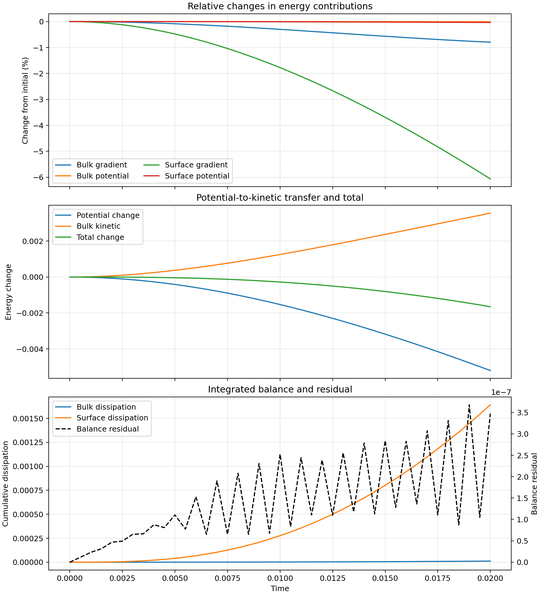

# Verifica energetica Allen–Cahn iperbolica: caso singolo

## Legge teorica

Per il ramo iperbolico bulk/parabolico superficiale non forzato implementato, l'energia che deve dissiparsi è

\[
E_{tot}(t)=\int_\Omega \frac{\rho}{2}u_t^2\,dx + E_{pot}(u),
\]

con

\[
E_{pot}=\int_\Omega\left(\frac{k}{2}|\nabla u|^2+mF(u)\right)dx
+\int_\Gamma\left(\frac{k}{2}|\nabla_\Gamma u|^2+\beta mF(u)\right)dS,
\qquad F(u)=\frac14(u^2-1)^2.
\]

La legge continua è

\[
\frac{dE_{tot}}{dt}=-\int_\Omega\rho\zeta u_t^2\,dx-\int_\Gamma c_\Gamma u_t^2\,dS\le 0.
\]

Quindi il potenziale può scendere convertendosi in energia cinetica: il confronto decisivo è sul totale e sul residuo integrato

\[
R(t)=E_{tot}(t)-E_{tot}(0)+D_{bulk}(t)+D_\Gamma(t),
\]

dove i due termini \(D\) sono le dissipazioni accumulate.
La derivazione e le ipotesi del modello sono riportate in [energy_theory.md](energy_theory.md).

## Caso ed esecuzione

È stato scelto un solo caso già presente: [input iperbolico 16×8, \(\Delta t=0.0005\)](energy_validation_runs_highprecision/hyperbolic_n16x8_dt0p0005/case.in). È non forzato (`manufactured 0`, nessun BC/carico), con `wave 1`, `rho=1`, `wavedamping=0.2`, `surfacecapacity=1`, `k=mobility=surfacebeta=1`, velocità iniziale nulla e bordo dinamico interamente discretizzato con `line1ht`.

L'input è stato eseguito una sola volta: 40 passi fino a \(T=0.02\), mesh 16×8 (128 elementi bulk e 48 elementi di bordo). Il run è stato scritto in una directory temporanea, senza sovrascrivere gli output preesistenti. Nessun raffinamento, scansione, MMS o WED è stato eseguito.

Il post-processing usa le routine energetiche già presenti in [run_energy_validation.py](run_energy_validation.py), con integrazione Gauss a 5 punti per gli addendi energetici. La dissipazione è integrata per passo usando la massa FEM bulk e di bordo e l'interpolazione lineare della velocità Newmark.

## Energie e bilancio

Valori nelle unità coerenti dell'input; `energia potenziale` è la somma dei quattro contributi gradiente/potenziale bulk e superficiali.

| Contributo | \(t=0\) | \(t=0.02\) |
|---|---:|---:|
| Gradiente bulk | 0.0301952314 | 0.0299550130 |
| Potenziale bulk | 0.4586761496 | 0.4586524250 |
| Cinetica bulk | 0 | 0.0035515557 |
| Gradiente superficiale | 0.0733119403 | 0.0688663344 |
| Potenziale superficiale | 1.3694228410 | 1.3689291793 |
| Potenziale totale | 1.9316061622 | 1.9264029517 |
| **Energia totale** | **1.9316061622** | **1.9299545074** |

La cinetica cresce di 0.00355156 mentre il potenziale cala di 0.00520321. Il totale diminuisce di 0.00165165; non ci sono aumenti del totale nei 40 intervalli osservati. La dissipazione accumulata è 0.0000113508 nel bulk e 0.0016406514 sulla superficie. Ne segue

- residuo finale \(R(T)=3.4727\cdot10^{-7}\), pari a \(1.7978\cdot10^{-7}\,E_{tot}(0)\);
- massimo residuo assoluto ai campioni: \(3.6793\cdot10^{-7}\) (massimo relativo \(1.9048\cdot10^{-7}\));
- incremento massimo dell'energia totale: nessuno positivo; il minimo incremento è \(-9.8551\cdot10^{-5}\).

Il residuo non è identicamente zero, ma è piccolo rispetto all'energia iniziale. La sua oscillazione tra campioni è visibile nel grafico e non va attribuita automaticamente al solo schema temporale.

## Grafici e dati

Il [CSV delle energie e del bilancio](energy_hyperbolic_single_test.csv) contiene i 41 campioni, gli addendi energetici, le dissipazioni per passo e cumulative, il residuo assoluto/normalizzato e l'incremento di energia totale.

## Velocità e schema temporale

In OOFEM la velocità è lo stato interno `waveVelocity`, aggiornato in `NLTransientTransportProblem::updateWaveKinematics` e restituito da `giveUnknownComponent(VM_Velocity, ...)` ([sorgente](../../src/tm/EngineeringModels/nltransienttransportproblem.C)). Per `newmarkbeta=0.25` e `newmarkgamma=0.5`, le equazioni di aggiornamento Newmark implicano

\[
v_{n+1}=\frac{2(u_{n+1}-u_n)}{\Delta t}-v_n.
\]

La velocità iniziale del caso è zero; la ricorrenza usata nel CSV coincide dunque algebricamente con lo stato di velocità Newmark, non con una derivata centrata o una stima indipendente. Tuttavia l'output del caso non salva `Velocity`: la ricostruzione usa gli spostamenti testuali, stampati con circa 8 cifre significative. La differenza temporale amplifica il loro arrotondamento (scala per passo dell'ordine di \(10^{-5}\) nella velocità). Perciò l'identità Newmark è verificata, ma non è possibile confrontare i valori ricostruiti con un dump ad alta precisione dello stato interno.

Per questo run lo schema non mostra crescita dell'energia totale ai tempi salvati e il bilancio è rispettato entro il residuo riportato. Il residuo finito indica una discrepanza numerica, ma con un solo passo temporale e velocità ricostruita da output arrotondato non si può separare l'errore di Newmark da quello di arrotondamento, quadratura, soluzione non lineare e post-processing. Il test non dimostra una proprietà di dissipazione discreta generale dello schema.

## Limiti

- Un solo caso, una mesh e un passo temporale: non misura ordine temporale né convergenza del residuo.
- Il campo di velocità effettivamente conservato dal solver non è esportato; il controllo usa l'identità cinematica Newmark applicata agli spostamenti stampati.
- Il bilancio è campionato ai passi salvati e dipende dalla quadratura e dalla ricostruzione FEM; non certifica eventuali variazioni intra-passo.
- L'assenza di crescita energetica osservata vale per questo input e questa discretizzazione, non per parametri o passi diversi.